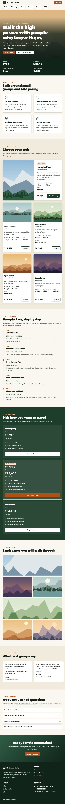
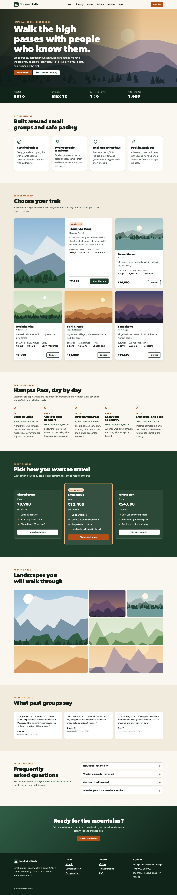

# Northwind Trails — Responsive Landing Page

Week 2 project for the Frontend Web Developer Internship: **Implementation of Responsive Web Design**.

Northwind Trails is a one-page site for a fictional small-group Himalayan trekking company. It is written mobile-first in HTML and CSS and adapts from 320 px phones to 1920 px desktops. There is no JavaScript on the page.

| 375 px | 768 px | 1440 px |
|---|---|---|
|  |  |  |

## Assignment objective

Build a website from scratch whose layout adjusts gracefully to desktops, tablets and smartphones using media queries, flexible grids and fluid images, and document the methods and layout adjustments.

## Technologies

- HTML5: semantic sections, `picture` art direction, `srcset`/`sizes`, native `details`/`summary`
- CSS3: Grid (with template areas), Flexbox, **container queries**, `clamp()`/`min()` fluid sizing, `auto-fit`/`minmax()`, `aspect-ratio`, `object-fit`, scroll snap, `prefers-reduced-motion`
- 27 WebP images (144 KB total) generated from SVG illustrations with `sharp`
- System fonts only, so there are no external requests

Dev-only tooling: sharp (image export), html-validate, csstree-validator, Puppeteer + Google Chrome (tests and screenshots).

## Responsive features

| Component | Phone | Tablet | Desktop |
|-----------|-------|--------|---------|
| Header | Logo + CTA, swipeable nav strip | same | single sticky row (≥ 52em) |
| Hero | tall 4:5 illustration, bottom gradient | tall | wide 16:7 panorama, side gradient |
| Features | 1 column | 2 columns | 3–4 columns (intrinsic `auto-fit`, no media query) |
| Treks | 1 column | 2 columns, featured spans both | 3 columns (≥ 68em) |
| Featured trek card | stacked | side by side (container query) | side by side |
| Itinerary | vertical timeline | vertical | 5 days across (≥ 68em) |
| Plans | stacked | stacked | 3 columns (≥ 52em) |
| Gallery | 2-column mosaic | 2-column | 4-column mosaic with 2×2 tile |
| Stories | swipeable scroll-snap row | swipeable | 3-column grid |
| Footer | 1 column | 2 columns | 4 columns |

Breakpoints are content-driven, in `em`: **36em**, **52em**, **68em**, plus a **max-height: 40em** query for short screens.

## Project structure

```
week-2-responsive-web-design/
├── index.html
├── css/styles.css                 mobile-first, 7 commented sections
├── assets/img/                    responsive WebP images
├── assets/icons/, assets/logo.svg
├── scripts/generate-images.mjs    draws the landscapes and exports WebP sizes
├── tests/responsive-check.mjs     automated checks at 7 viewport settings
├── docs/screenshots/              full-page screenshots at 320–1920 px
├── package.json, .htmlvalidate.json, .gitignore
├── report.docx                    technical documentation
├── README.md
└── TESTING.md
```

## Run it

No build step is needed. Open `index.html`, or serve the folder:

```bash
python3 -m http.server 8000
```

then visit <http://localhost:8000> and resize the window (or use DevTools device mode).

## Test it

Requires Node.js 18+ and Google Chrome (`CHROME_PATH` overrides the default macOS path).

```bash
npm install
npm test               # validators + responsive checks at 320, 375, 375@2x, 768, 1024, 1440, 1920
npm run screenshots    # regenerate docs/screenshots
npm run images         # regenerate assets/img from the SVG scene definitions
```

Results are in [TESTING.md](TESTING.md).

## Implementation notes

- The hero image is absolutely positioned inside `picture` and uses `object-fit: cover`, so the text decides the hero height (this fixed a 960 px-tall hero on tablets).
- Trek cards are the same markup everywhere; `container-type: inline-size` on each grid item lets the featured card go horizontal when its cell is ≥ 34rem.
- The story row and the nav strip scroll inside their own containers; the page itself has zero horizontal overflow at every tested width.
- All buttons, nav pills and FAQ summaries are at least 44 px tall.

## Known limitations

- Fictional content; images are generated illustrations, not photos.
- Enquiries are `mailto:` links; there is no booking backend.
- Container queries need a 2023 or newer browser (older ones fall back to the stacked card).
- Tested in Chromium only (headless Chrome and the Claude desktop app's browser pane); not on Safari, Firefox or physical devices.
